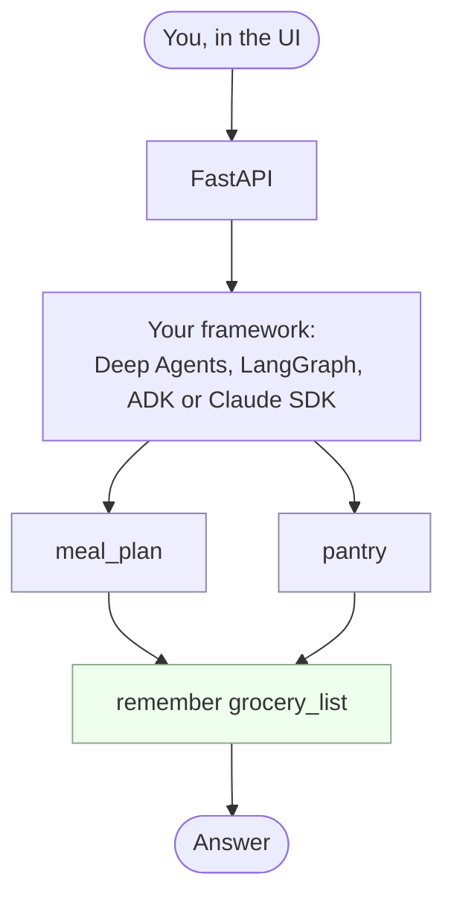

# 061. Grocery list from this week's meals

**Area:** Shopping, groceries and errands  
**Features:** parallel calls, memory, uses preferences

Reads the meal plan and pantry and adds only what's missing, for your diet.

## What you ask

> Make my grocery list for this week's meal plan.

## Flow



## Tools

| Tool | Effect | Control |
|---|---|---|
| `meal_plan`: This week's meal plan. | read-only | - |
| `pantry`: Pantry items. | read-only | - |

## Preferences it uses

| Preference | Default |
|---|---|
| `diet` | vegetarian |

## Run it

```bash
python usecases/061_grocery_list_from_meals/usecase.py                 # your preferred framework
python usecases/061_grocery_list_from_meals/usecase.py --all           # all four frameworks
python usecases/061_grocery_list_from_meals/usecase.py --manual        # answer the approvals yourself
python usecases/061_grocery_list_from_meals/usecase.py --framework adk --live   # Gemini decides (needs GOOGLE_API_KEY)
```

Or start the app (`uvicorn app.api:app`), open http://localhost:8000 and pick it from the list.
