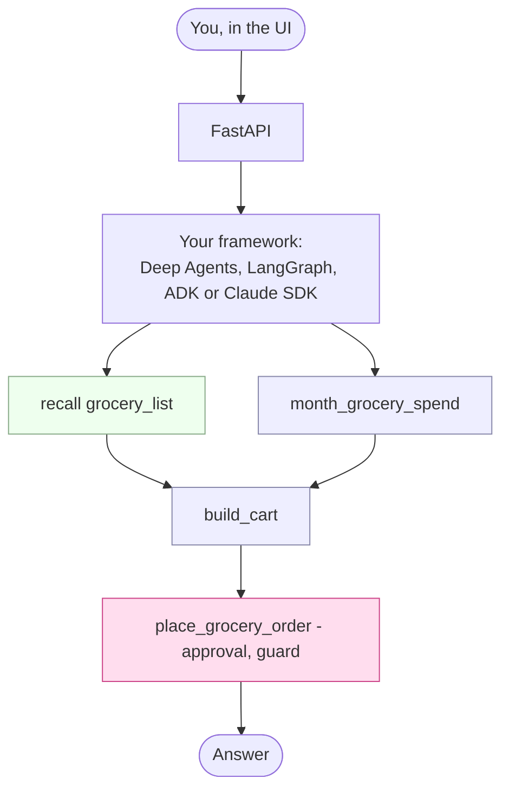

# 062. Order groceries for delivery

**Area:** Shopping, groceries and errands  
**Features:** parallel calls, approval, guard, memory

Builds the cart and checks it against your monthly grocery budget before ordering.

## What you ask

> Order my grocery list for Saturday morning delivery.

## Flow



## Tools

| Tool | Effect | Control |
|---|---|---|
| `build_cart`: Build a grocery cart. | read-only | - |
| `month_grocery_spend`: Grocery spending so far this month. | read-only | - |
| `place_grocery_order`: Place a grocery order. | spends money | approval, guard |

## Approvals

In the UI the run pauses and you decide. With auto-approve (demo), these decisions are used:

- `place_grocery_order`: approve

## Guards

Checked in the shared tool layer before the tool runs, the same on every framework. Guards get your preferences, so changing a limit in the UI changes what's allowed.

- `place_grocery_order`

## Run it

```bash
python usecases/062_order_groceries/usecase.py                 # your preferred framework
python usecases/062_order_groceries/usecase.py --all           # all four frameworks
python usecases/062_order_groceries/usecase.py --manual        # answer the approvals yourself
python usecases/062_order_groceries/usecase.py --framework adk --live   # Gemini decides (needs GOOGLE_API_KEY)
```

Or start the app (`uvicorn app.api:app`), open http://localhost:8000 and pick it from the list.
