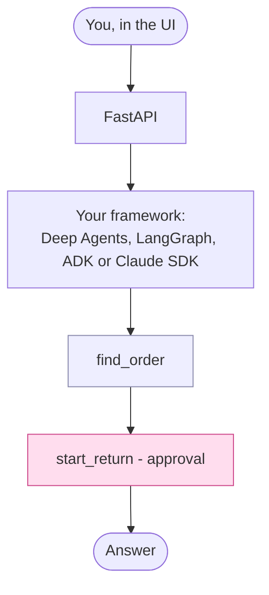

# 064. Start a return

**Area:** Shopping, groceries and errands  
**Features:** approval

Finds the order, checks the return window and starts the return after approval.

## What you ask

> Return the shoes that don't fit.

## Flow



## Tools

| Tool | Effect | Control |
|---|---|---|
| `find_order`: Find an order. | read-only | - |
| `start_return`: Start a return. | talks to someone else | approval |

## Approvals

In the UI the run pauses and you decide. With auto-approve (demo), these decisions are used:

- `start_return`: approve

## Run it

```bash
python usecases/064_return_an_item/usecase.py                 # your preferred framework
python usecases/064_return_an_item/usecase.py --all           # all four frameworks
python usecases/064_return_an_item/usecase.py --manual        # answer the approvals yourself
python usecases/064_return_an_item/usecase.py --framework adk --live   # Gemini decides (needs GOOGLE_API_KEY)
```

Or start the app (`uvicorn app.api:app`), open http://localhost:8000 and pick it from the list.
