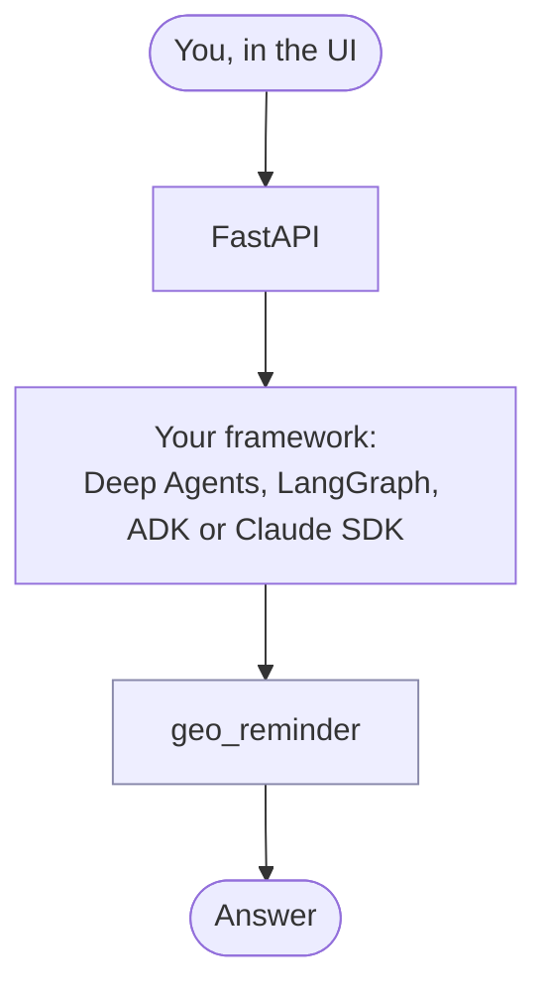

# 067. Dry cleaning reminder

**Area:** Shopping, groceries and errands  
**Features:** tools only

Creates a location-based reminder.

## What you ask

> Remind me to pick up dry cleaning when I'm near it.

## Flow



## Tools

| Tool | Effect | Control |
|---|---|---|
| `geo_reminder`: Reminder at a place. | changes your data | - |

## Run it

```bash
python usecases/067_dry_cleaning_reminder/usecase.py                 # your preferred framework
python usecases/067_dry_cleaning_reminder/usecase.py --all           # all four frameworks
python usecases/067_dry_cleaning_reminder/usecase.py --manual        # answer the approvals yourself
python usecases/067_dry_cleaning_reminder/usecase.py --framework adk --live   # Gemini decides (needs GOOGLE_API_KEY)
```

Or start the app (`uvicorn app.api:app`), open http://localhost:8000 and pick it from the list.
