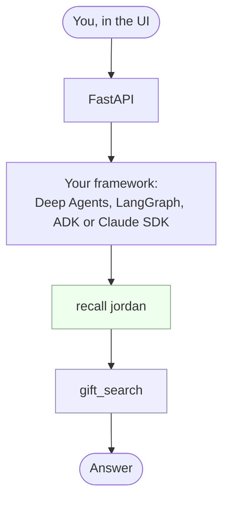

# 068. Gift ideas

**Area:** Shopping, groceries and errands  
**Features:** memory

Uses what you've saved about Jordan's interests.

## What you ask

> Gift ideas for Jordan's birthday under $100?

## Flow



## Tools

| Tool | Effect | Control |
|---|---|---|
| `gift_search`: Search gifts. | read-only | - |

## Run it

```bash
python usecases/068_gift_ideas/usecase.py                 # your preferred framework
python usecases/068_gift_ideas/usecase.py --all           # all four frameworks
python usecases/068_gift_ideas/usecase.py --manual        # answer the approvals yourself
python usecases/068_gift_ideas/usecase.py --framework adk --live   # Gemini decides (needs GOOGLE_API_KEY)
```

Or start the app (`uvicorn app.api:app`), open http://localhost:8000 and pick it from the list.
