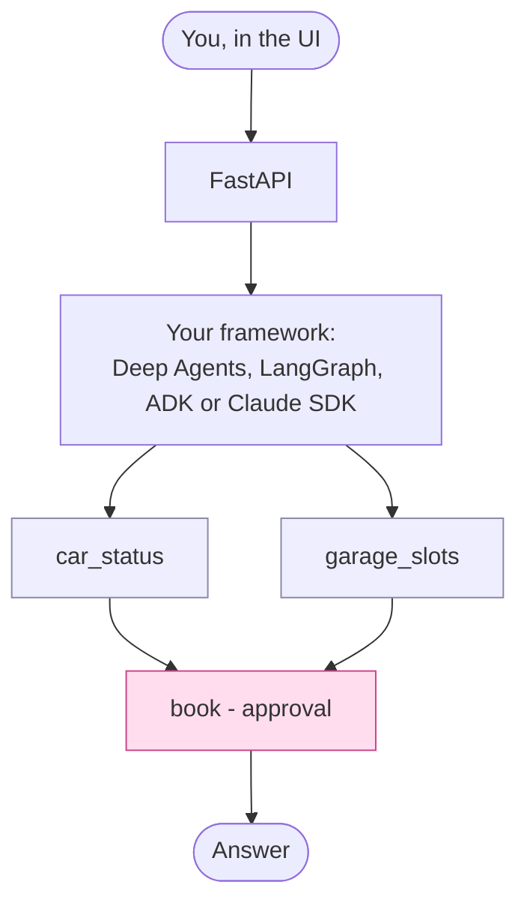

# 070. Book a car service

**Area:** Shopping, groceries and errands  
**Features:** parallel calls, approval

Checks mileage, finds a slot that fits your calendar, books after approval.

## What you ask

> My car is due for an oil change. Book it.

## Flow



## Tools

| Tool | Effect | Control |
|---|---|---|
| `car_status`: Car mileage and service due. | read-only | - |
| `garage_slots`: Garage slots. | read-only | - |
| `book`: Book a slot. | talks to someone else | approval |

## Approvals

In the UI the run pauses and you decide. With auto-approve (demo), these decisions are used:

- `book`: approve

## Run it

```bash
python usecases/070_car_service/usecase.py                 # your preferred framework
python usecases/070_car_service/usecase.py --all           # all four frameworks
python usecases/070_car_service/usecase.py --manual        # answer the approvals yourself
python usecases/070_car_service/usecase.py --framework adk --live   # Gemini decides (needs GOOGLE_API_KEY)
```

Or start the app (`uvicorn app.api:app`), open http://localhost:8000 and pick it from the list.
