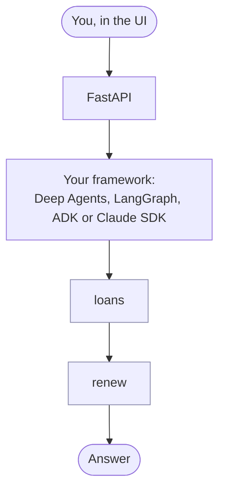

# 071. Library books due

**Area:** Shopping, groceries and errands  
**Features:** tools only

Checks the loans and renews the ones it can.

## What you ask

> Any library books due?

## Flow



## Tools

| Tool | Effect | Control |
|---|---|---|
| `loans`: Library loans. | read-only | - |
| `renew`: Renew a loan. | changes your data | - |

## Run it

```bash
python usecases/071_library_books/usecase.py                 # your preferred framework
python usecases/071_library_books/usecase.py --all           # all four frameworks
python usecases/071_library_books/usecase.py --manual        # answer the approvals yourself
python usecases/071_library_books/usecase.py --framework adk --live   # Gemini decides (needs GOOGLE_API_KEY)
```

Or start the app (`uvicorn app.api:app`), open http://localhost:8000 and pick it from the list.
