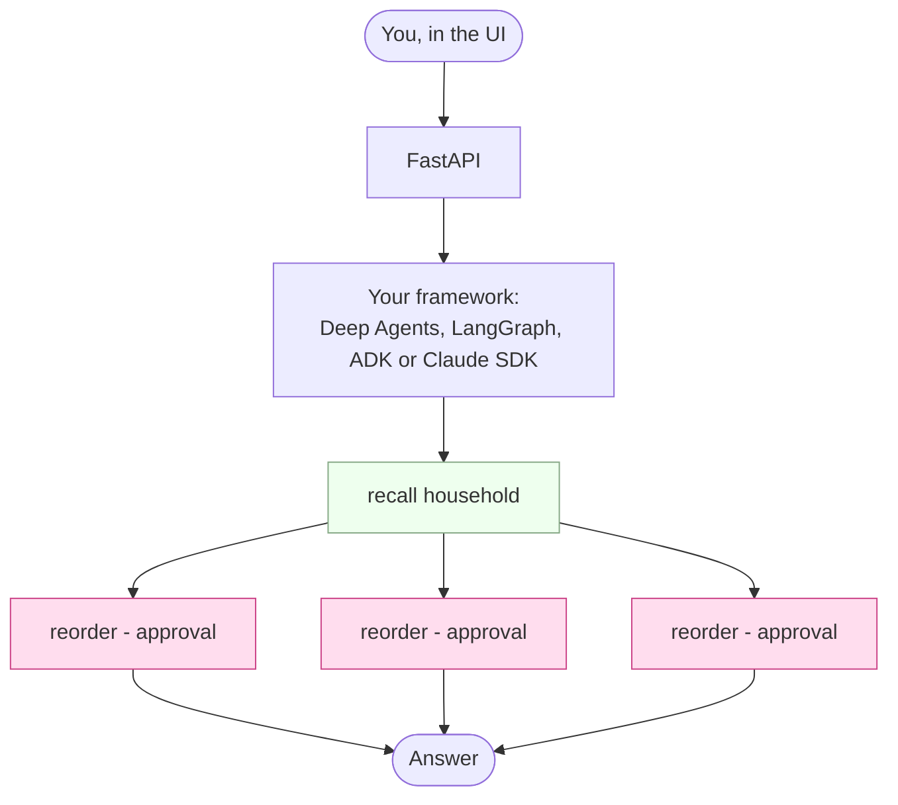

# 072. Restock household basics

**Area:** Shopping, groceries and errands  
**Features:** parallel calls, approval, memory

Reorders your usual basics from memory. You drop one item before it orders.

## What you ask

> Restock the usual household stuff.

## Flow



## Tools

| Tool | Effect | Control |
|---|---|---|
| `reorder`: Reorder an item. | spends money | approval |

## Approvals

In the UI the run pauses and you decide. With auto-approve (demo), these decisions are used:

- `reorder`: call 1: approve; call 2: reject; call 3: approve

## Run it

```bash
python usecases/072_restock_household/usecase.py                 # your preferred framework
python usecases/072_restock_household/usecase.py --all           # all four frameworks
python usecases/072_restock_household/usecase.py --manual        # answer the approvals yourself
python usecases/072_restock_household/usecase.py --framework adk --live   # Gemini decides (needs GOOGLE_API_KEY)
```

Or start the app (`uvicorn app.api:app`), open http://localhost:8000 and pick it from the list.
