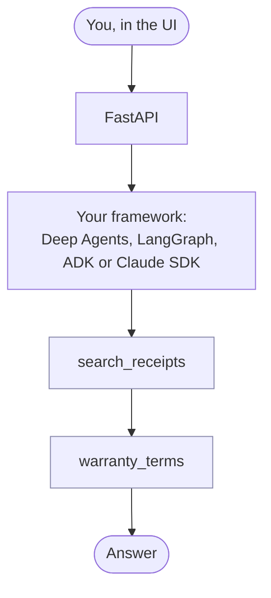

# 075. Is it still under warranty

**Area:** Shopping, groceries and errands  
**Features:** tools only

Finds the purchase receipt and the warranty terms.

## What you ask

> Is the dishwasher still under warranty?

## Flow



## Tools

| Tool | Effect | Control |
|---|---|---|
| `search_receipts`: Search email receipts. | read-only | - |
| `warranty_terms`: Warranty terms for a product. | read-only | - |

## Run it

```bash
python usecases/075_warranty_lookup/usecase.py                 # your preferred framework
python usecases/075_warranty_lookup/usecase.py --all           # all four frameworks
python usecases/075_warranty_lookup/usecase.py --manual        # answer the approvals yourself
python usecases/075_warranty_lookup/usecase.py --framework adk --live   # Gemini decides (needs GOOGLE_API_KEY)
```

Or start the app (`uvicorn app.api:app`), open http://localhost:8000 and pick it from the list.
