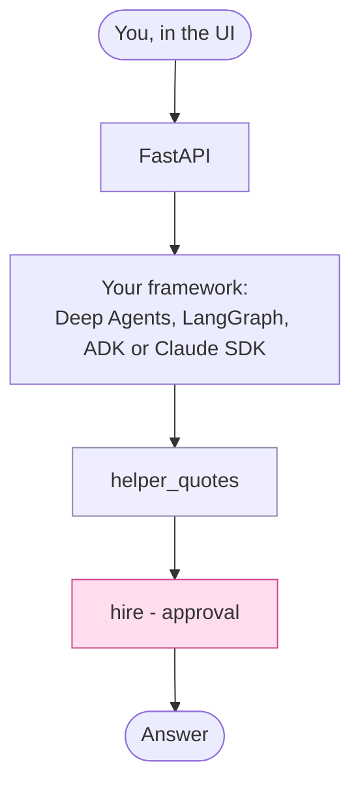

# 076. Hire help for a task

**Area:** Shopping, groceries and errands  
**Features:** approval

Compares task-helper quotes and books after approval.

## What you ask

> Find someone to assemble a bookshelf this weekend.

## Flow



## Tools

| Tool | Effect | Control |
|---|---|---|
| `helper_quotes`: Quotes for a task. | read-only | - |
| `hire`: Hire a helper. | spends money | approval |

## Approvals

In the UI the run pauses and you decide. With auto-approve (demo), these decisions are used:

- `hire`: approve

## Run it

```bash
python usecases/076_furniture_assembly/usecase.py                 # your preferred framework
python usecases/076_furniture_assembly/usecase.py --all           # all four frameworks
python usecases/076_furniture_assembly/usecase.py --manual        # answer the approvals yourself
python usecases/076_furniture_assembly/usecase.py --framework adk --live   # Gemini decides (needs GOOGLE_API_KEY)
```

Or start the app (`uvicorn app.api:app`), open http://localhost:8000 and pick it from the list.
