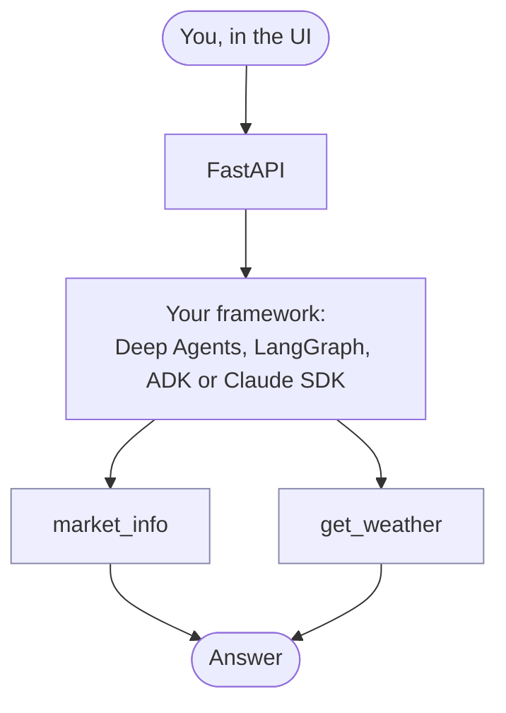

# 077. Farmers market this weekend

**Area:** Shopping, groceries and errands  
**Features:** parallel calls, uses preferences

Checks the market and the weather together.

## What you ask

> What's at the farmers market this weekend?

## Flow



## Tools

| Tool | Effect | Control |
|---|---|---|
| `market_info`: Farmers market info. | read-only | - |
| `get_weather`: Weather for a city. | read-only | - |

## Preferences it uses

| Preference | Default |
|---|---|
| `home_city` | Chicago |

## Run it

```bash
python usecases/077_farmers_market/usecase.py                 # your preferred framework
python usecases/077_farmers_market/usecase.py --all           # all four frameworks
python usecases/077_farmers_market/usecase.py --manual        # answer the approvals yourself
python usecases/077_farmers_market/usecase.py --framework adk --live   # Gemini decides (needs GOOGLE_API_KEY)
```

Or start the app (`uvicorn app.api:app`), open http://localhost:8000 and pick it from the list.
