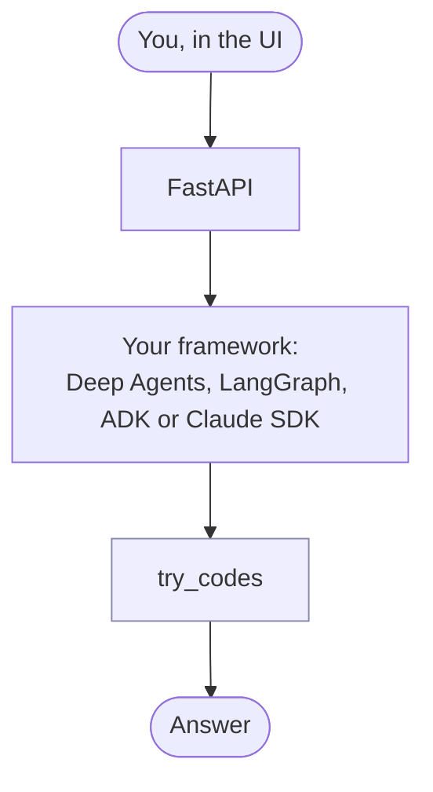

# 079. Coupons before I check out

**Area:** Shopping, groceries and errands  
**Features:** tools only

Tries the available codes and keeps the best one.

## What you ask

> Any coupons for my HomeMart cart?

## Flow



## Tools

| Tool | Effect | Control |
|---|---|---|
| `try_codes`: Try coupon codes on a cart. | read-only | - |

## Run it

```bash
python usecases/079_coupon_finder/usecase.py                 # your preferred framework
python usecases/079_coupon_finder/usecase.py --all           # all four frameworks
python usecases/079_coupon_finder/usecase.py --manual        # answer the approvals yourself
python usecases/079_coupon_finder/usecase.py --framework adk --live   # Gemini decides (needs GOOGLE_API_KEY)
```

Or start the app (`uvicorn app.api:app`), open http://localhost:8000 and pick it from the list.
