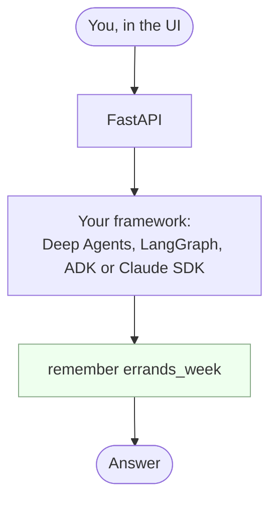

# 080. Weekly errand list

**Area:** Shopping, groceries and errands  
**Features:** memory

Saves the list to memory so other tasks (route planning, reminders) can use it.

## What you ask

> Save this week's errands: post office, return shoes, pick up dry cleaning.

## Flow



## Tools

| Tool | Effect | Control |
|---|---|---|
| (only `remember` / `recall`) | memory | - |

## Run it

```bash
python usecases/080_weekly_errand_list/usecase.py                 # your preferred framework
python usecases/080_weekly_errand_list/usecase.py --all           # all four frameworks
python usecases/080_weekly_errand_list/usecase.py --manual        # answer the approvals yourself
python usecases/080_weekly_errand_list/usecase.py --framework adk --live   # Gemini decides (needs GOOGLE_API_KEY)
```

Or start the app (`uvicorn app.api:app`), open http://localhost:8000 and pick it from the list.
