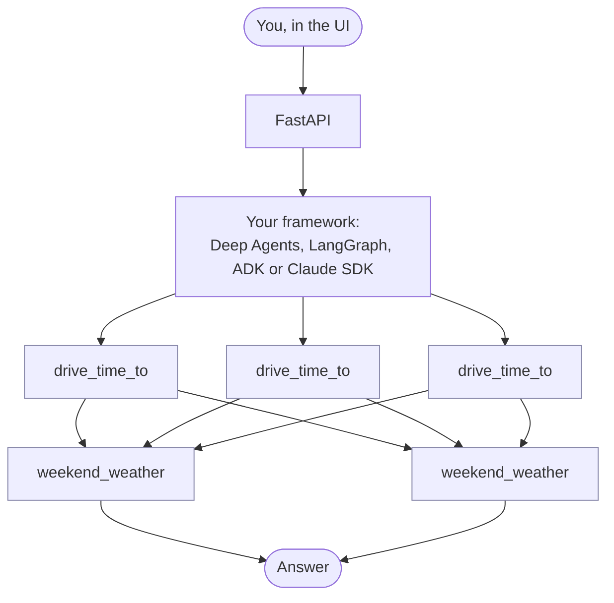

# 081. Weekend trip ideas

**Area:** Travel and getting around  
**Features:** parallel calls, uses preferences

Checks drive times and weekend weather for a few places in parallel.

## What you ask

> Ideas for a weekend away within 4 hours' drive?

## Flow



## Tools

| Tool | Effect | Control |
|---|---|---|
| `drive_time_to`: Drive time from your city. | read-only | - |
| `weekend_weather`: Weekend forecast. | read-only | - |

## Preferences it uses

| Preference | Default |
|---|---|
| `home_city` | Chicago |

## Run it

```bash
python usecases/081_weekend_trip_ideas/usecase.py                 # your preferred framework
python usecases/081_weekend_trip_ideas/usecase.py --all           # all four frameworks
python usecases/081_weekend_trip_ideas/usecase.py --manual        # answer the approvals yourself
python usecases/081_weekend_trip_ideas/usecase.py --framework adk --live   # Gemini decides (needs GOOGLE_API_KEY)
```

Or start the app (`uvicorn app.api:app`), open http://localhost:8000 and pick it from the list.
