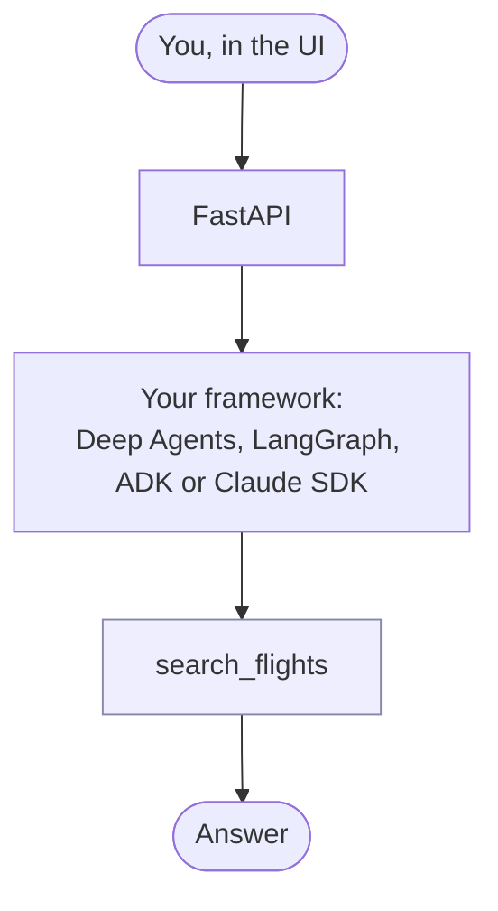

# 082. Find flights

**Area:** Travel and getting around  
**Features:** uses preferences

Searches with your seat preference and shows the best options.

## What you ask

> Find flights to Denver for Dec 12-15.

## Flow



## Tools

| Tool | Effect | Control |
|---|---|---|
| `search_flights`: Search flights. | read-only | - |

## Preferences it uses

| Preference | Default |
|---|---|
| `seat_preference` | aisle |

## Run it

```bash
python usecases/082_flight_search/usecase.py                 # your preferred framework
python usecases/082_flight_search/usecase.py --all           # all four frameworks
python usecases/082_flight_search/usecase.py --manual        # answer the approvals yourself
python usecases/082_flight_search/usecase.py --framework adk --live   # Gemini decides (needs GOOGLE_API_KEY)
```

Or start the app (`uvicorn app.api:app`), open http://localhost:8000 and pick it from the list.
