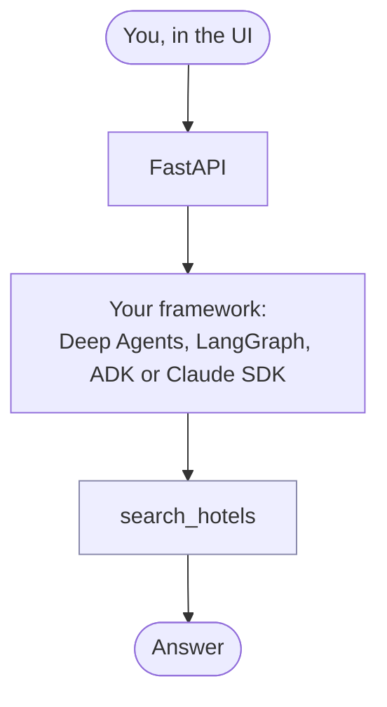

# 084. Hotel shortlist

**Area:** Travel and getting around  
**Features:** tools only

Searches and filters by price and distance.

## What you ask

> Hotels near the conference center in Denver under $200?

## Flow



## Tools

| Tool | Effect | Control |
|---|---|---|
| `search_hotels`: Search hotels. | read-only | - |

## Run it

```bash
python usecases/084_hotel_shortlist/usecase.py                 # your preferred framework
python usecases/084_hotel_shortlist/usecase.py --all           # all four frameworks
python usecases/084_hotel_shortlist/usecase.py --manual        # answer the approvals yourself
python usecases/084_hotel_shortlist/usecase.py --framework adk --live   # Gemini decides (needs GOOGLE_API_KEY)
```

Or start the app (`uvicorn app.api:app`), open http://localhost:8000 and pick it from the list.
