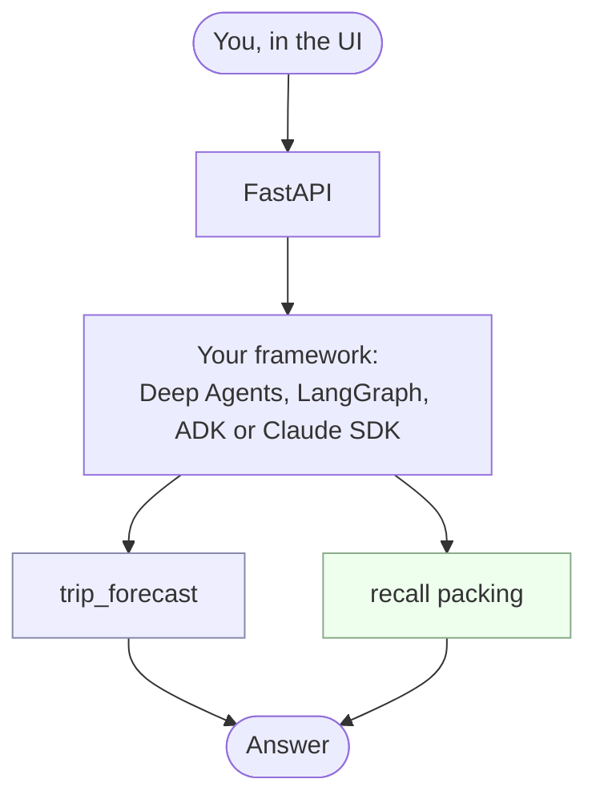

# 085. Packing list

**Area:** Travel and getting around  
**Features:** parallel calls, memory

Uses the forecast, the trip length and your saved packing basics.

## What you ask

> Make a packing list for Denver.

## Flow



## Tools

| Tool | Effect | Control |
|---|---|---|
| `trip_forecast`: Forecast for trip dates. | read-only | - |

## Run it

```bash
python usecases/085_packing_list/usecase.py                 # your preferred framework
python usecases/085_packing_list/usecase.py --all           # all four frameworks
python usecases/085_packing_list/usecase.py --manual        # answer the approvals yourself
python usecases/085_packing_list/usecase.py --framework adk --live   # Gemini decides (needs GOOGLE_API_KEY)
```

Or start the app (`uvicorn app.api:app`), open http://localhost:8000 and pick it from the list.
