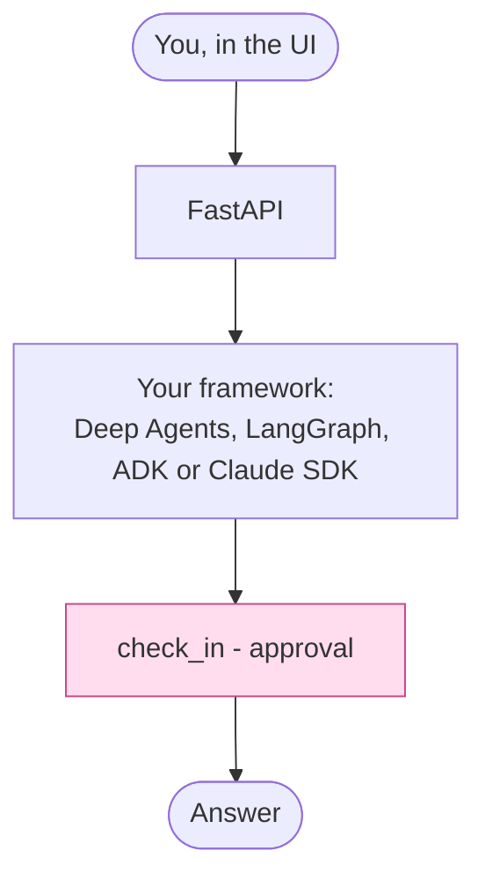

# 086. Flight check-in

**Area:** Travel and getting around  
**Features:** approval, uses preferences

Checks in when the window opens and asks for your seat preference.

## What you ask

> Check me in for tomorrow's flight.

## Flow



## Tools

| Tool | Effect | Control |
|---|---|---|
| `check_in`: Check in for a flight. | talks to someone else | approval |

## Approvals

In the UI the run pauses and you decide. With auto-approve (demo), these decisions are used:

- `check_in`: approve

## Preferences it uses

| Preference | Default |
|---|---|
| `seat_preference` | aisle |

## Run it

```bash
python usecases/086_check_in_reminder/usecase.py                 # your preferred framework
python usecases/086_check_in_reminder/usecase.py --all           # all four frameworks
python usecases/086_check_in_reminder/usecase.py --manual        # answer the approvals yourself
python usecases/086_check_in_reminder/usecase.py --framework adk --live   # Gemini decides (needs GOOGLE_API_KEY)
```

Or start the app (`uvicorn app.api:app`), open http://localhost:8000 and pick it from the list.
