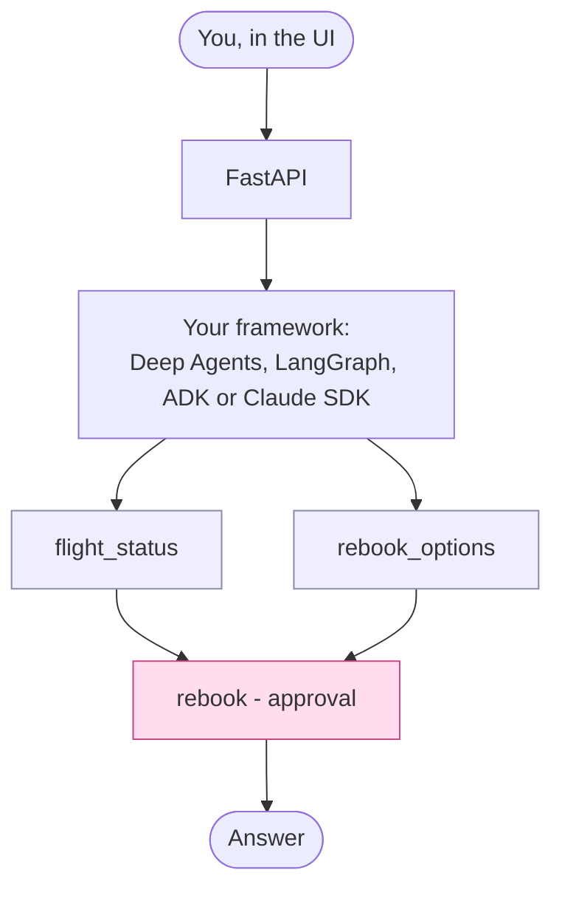

# 087. My flight is delayed

**Area:** Travel and getting around  
**Features:** parallel calls, approval

Pulls rebooking options. Switching flights needs your approval.

## What you ask

> My flight is delayed 3 hours. Options?

## Flow



## Tools

| Tool | Effect | Control |
|---|---|---|
| `flight_status`: Status of a flight. | read-only | - |
| `rebook_options`: Alternative flights. | read-only | - |
| `rebook`: Switch to another flight. | talks to someone else | approval |

## Approvals

In the UI the run pauses and you decide. With auto-approve (demo), these decisions are used:

- `rebook`: approve

## Run it

```bash
python usecases/087_flight_delay_rebook/usecase.py                 # your preferred framework
python usecases/087_flight_delay_rebook/usecase.py --all           # all four frameworks
python usecases/087_flight_delay_rebook/usecase.py --manual        # answer the approvals yourself
python usecases/087_flight_delay_rebook/usecase.py --framework adk --live   # Gemini decides (needs GOOGLE_API_KEY)
```

Or start the app (`uvicorn app.api:app`), open http://localhost:8000 and pick it from the list.
