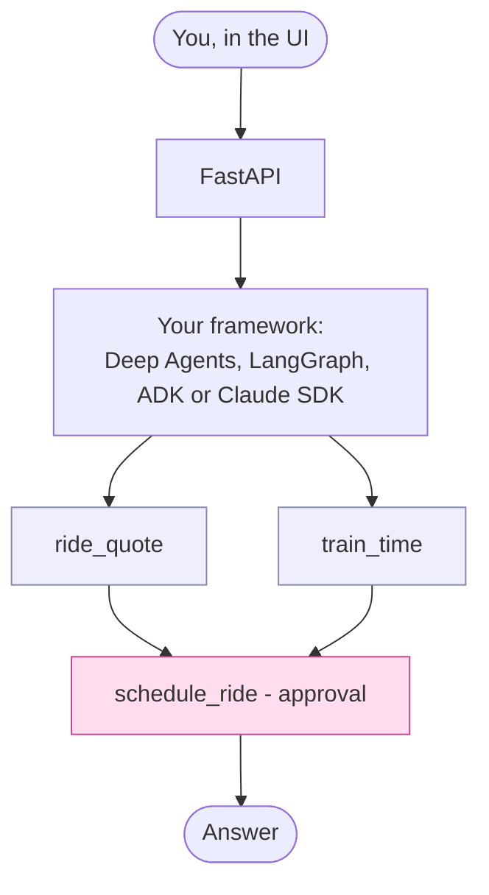

# 088. Ride to the airport

**Area:** Travel and getting around  
**Features:** parallel calls, approval, uses preferences

Compares rideshare and train and schedules a ride after approval.

## What you ask

> Get me to O'Hare by 6am tomorrow.

## Flow



## Tools

| Tool | Effect | Control |
|---|---|---|
| `ride_quote`: Rideshare quote. | read-only | - |
| `train_time`: Train time to the airport. | read-only | - |
| `schedule_ride`: Schedule a ride. | spends money | approval |

## Approvals

In the UI the run pauses and you decide. With auto-approve (demo), these decisions are used:

- `schedule_ride`: approve

## Preferences it uses

| Preference | Default |
|---|---|
| `home_city` | Chicago |

## Run it

```bash
python usecases/088_airport_ride/usecase.py                 # your preferred framework
python usecases/088_airport_ride/usecase.py --all           # all four frameworks
python usecases/088_airport_ride/usecase.py --manual        # answer the approvals yourself
python usecases/088_airport_ride/usecase.py --framework adk --live   # Gemini decides (needs GOOGLE_API_KEY)
```

Or start the app (`uvicorn app.api:app`), open http://localhost:8000 and pick it from the list.
