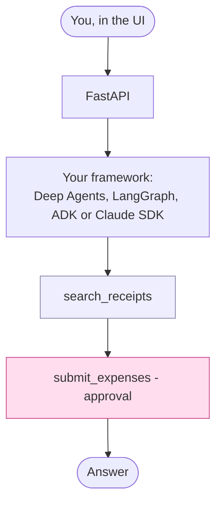

# 089. File trip expenses

**Area:** Travel and getting around  
**Features:** approval

Collects receipts from email and submits the expense report after approval.

## What you ask

> File my Denver trip expenses.

## Flow



## Tools

| Tool | Effect | Control |
|---|---|---|
| `search_receipts`: Search email receipts. | read-only | - |
| `submit_expenses`: Submit an expense report. | talks to someone else | approval |

## Approvals

In the UI the run pauses and you decide. With auto-approve (demo), these decisions are used:

- `submit_expenses`: approve

## Run it

```bash
python usecases/089_expense_trip_receipts/usecase.py                 # your preferred framework
python usecases/089_expense_trip_receipts/usecase.py --all           # all four frameworks
python usecases/089_expense_trip_receipts/usecase.py --manual        # answer the approvals yourself
python usecases/089_expense_trip_receipts/usecase.py --framework adk --live   # Gemini decides (needs GOOGLE_API_KEY)
```

Or start the app (`uvicorn app.api:app`), open http://localhost:8000 and pick it from the list.
