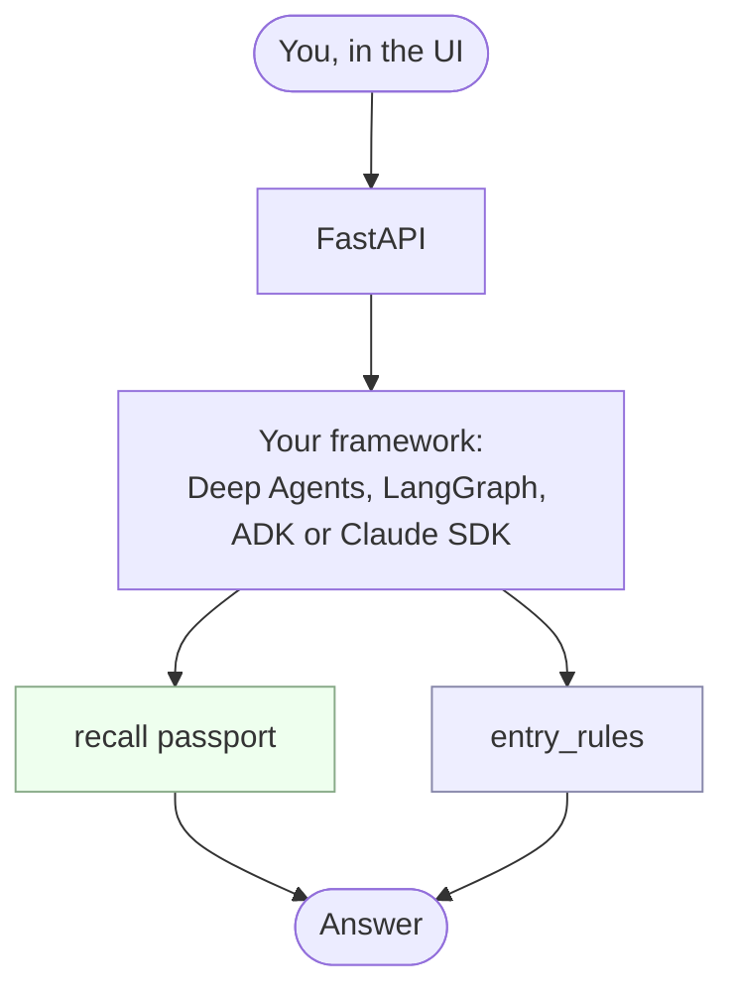

# 090. Passport expiry check

**Area:** Travel and getting around  
**Features:** parallel calls, memory

Checks the expiry date you saved against the entry rules.

## What you ask

> Is my passport OK for Spain next spring?

## Flow



## Tools

| Tool | Effect | Control |
|---|---|---|
| `entry_rules`: Entry rules for a country. | read-only | - |

## Run it

```bash
python usecases/090_passport_expiry/usecase.py                 # your preferred framework
python usecases/090_passport_expiry/usecase.py --all           # all four frameworks
python usecases/090_passport_expiry/usecase.py --manual        # answer the approvals yourself
python usecases/090_passport_expiry/usecase.py --framework adk --live   # Gemini decides (needs GOOGLE_API_KEY)
```

Or start the app (`uvicorn app.api:app`), open http://localhost:8000 and pick it from the list.
