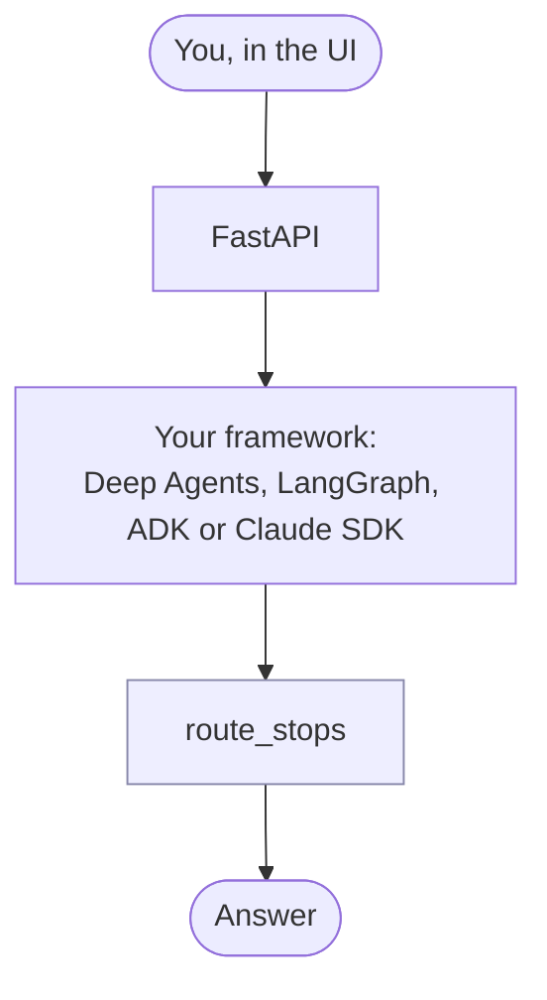

# 091. Road trip stops

**Area:** Travel and getting around  
**Features:** uses preferences

Finds dog-friendly stops every two hours or so.

## What you ask

> Plan stops for the drive to Nashville with the dog.

## Flow



## Tools

| Tool | Effect | Control |
|---|---|---|
| `route_stops`: Stops along a route. | read-only | - |

## Preferences it uses

| Preference | Default |
|---|---|
| `dog` | Biscuit |
| `home_city` | Chicago |

## Run it

```bash
python usecases/091_road_trip_stops/usecase.py                 # your preferred framework
python usecases/091_road_trip_stops/usecase.py --all           # all four frameworks
python usecases/091_road_trip_stops/usecase.py --manual        # answer the approvals yourself
python usecases/091_road_trip_stops/usecase.py --framework adk --live   # Gemini decides (needs GOOGLE_API_KEY)
```

Or start the app (`uvicorn app.api:app`), open http://localhost:8000 and pick it from the list.
