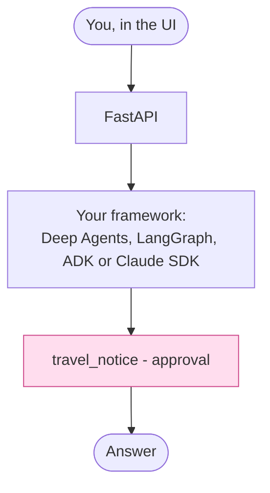

# 092. Travel money setup

**Area:** Travel and getting around  
**Features:** approval

Adds a travel notice. Changing card settings needs approval.

## What you ask

> Set up my card for the Spain trip.

## Flow



## Tools

| Tool | Effect | Control |
|---|---|---|
| `travel_notice`: Add a travel notice to a card. | changes your data | approval |

## Approvals

In the UI the run pauses and you decide. With auto-approve (demo), these decisions are used:

- `travel_notice`: approve

## Run it

```bash
python usecases/092_currency_and_cards/usecase.py                 # your preferred framework
python usecases/092_currency_and_cards/usecase.py --all           # all four frameworks
python usecases/092_currency_and_cards/usecase.py --manual        # answer the approvals yourself
python usecases/092_currency_and_cards/usecase.py --framework adk --live   # Gemini decides (needs GOOGLE_API_KEY)
```

Or start the app (`uvicorn app.api:app`), open http://localhost:8000 and pick it from the list.
