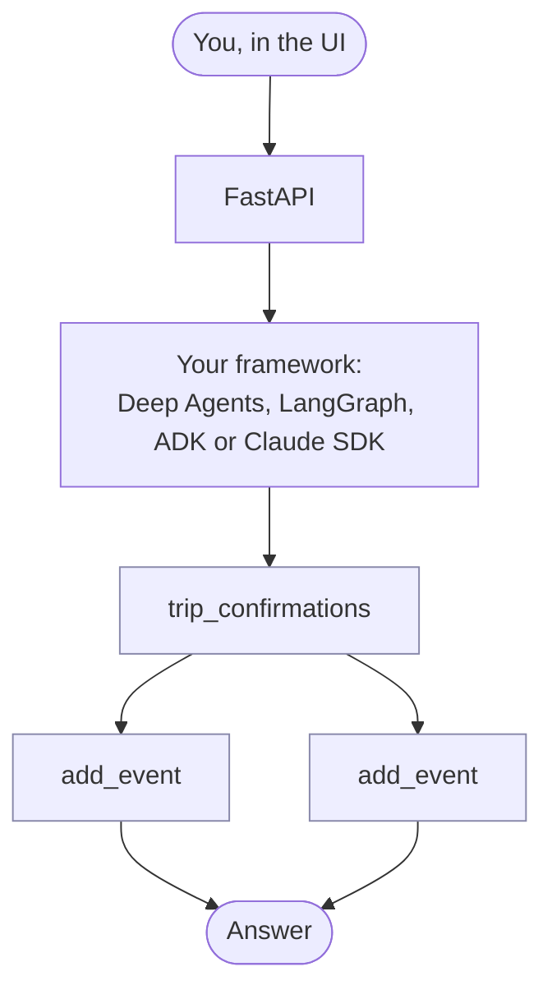

# 093. Trip itinerary to calendar

**Area:** Travel and getting around  
**Features:** parallel calls

Reads the confirmation emails and creates the events.

## What you ask

> Put my Denver itinerary on my calendar.

## Flow



## Tools

| Tool | Effect | Control |
|---|---|---|
| `trip_confirmations`: Booking confirmations. | read-only | - |
| `add_event`: Add a calendar event. | changes your data | - |

## Run it

```bash
python usecases/093_itinerary_to_calendar/usecase.py                 # your preferred framework
python usecases/093_itinerary_to_calendar/usecase.py --all           # all four frameworks
python usecases/093_itinerary_to_calendar/usecase.py --manual        # answer the approvals yourself
python usecases/093_itinerary_to_calendar/usecase.py --framework adk --live   # Gemini decides (needs GOOGLE_API_KEY)
```

Or start the app (`uvicorn app.api:app`), open http://localhost:8000 and pick it from the list.
