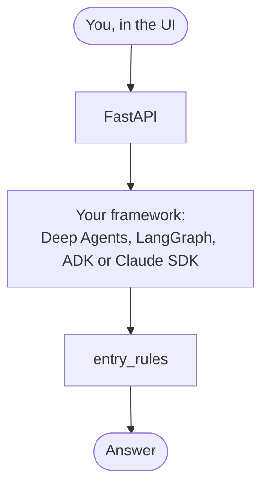

# 095. Do I need a visa

**Area:** Travel and getting around  
**Features:** tools only

Checks the current entry rules.

## What you ask

> Do I need a visa for a week in Japan?

## Flow



## Tools

| Tool | Effect | Control |
|---|---|---|
| `entry_rules`: Entry rules. | read-only | - |

## Run it

```bash
python usecases/095_visa_requirements/usecase.py                 # your preferred framework
python usecases/095_visa_requirements/usecase.py --all           # all four frameworks
python usecases/095_visa_requirements/usecase.py --manual        # answer the approvals yourself
python usecases/095_visa_requirements/usecase.py --framework adk --live   # Gemini decides (needs GOOGLE_API_KEY)
```

Or start the app (`uvicorn app.api:app`), open http://localhost:8000 and pick it from the list.
