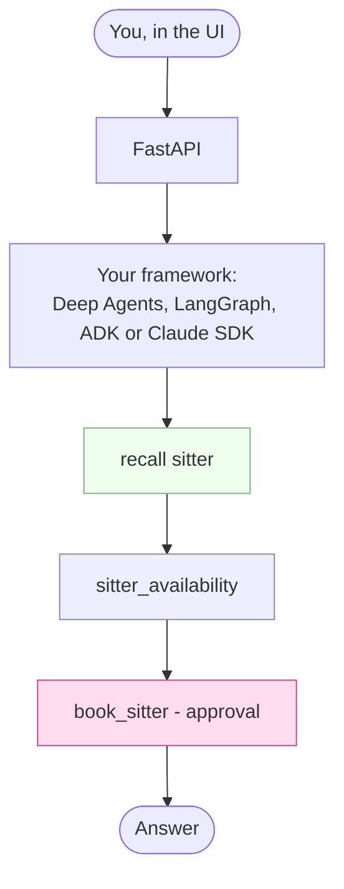

# 096. Book a pet sitter

**Area:** Travel and getting around  
**Features:** approval, memory, uses preferences

Uses the sitter you saved in memory and books after approval.

## What you ask

> Book a sitter for Biscuit while I'm in Denver.

## Flow



## Tools

| Tool | Effect | Control |
|---|---|---|
| `sitter_availability`: Sitter availability. | read-only | - |
| `book_sitter`: Book the sitter. | spends money | approval |

## Approvals

In the UI the run pauses and you decide. With auto-approve (demo), these decisions are used:

- `book_sitter`: approve

## Preferences it uses

| Preference | Default |
|---|---|
| `dog` | Biscuit |

## Run it

```bash
python usecases/096_pet_sitter/usecase.py                 # your preferred framework
python usecases/096_pet_sitter/usecase.py --all           # all four frameworks
python usecases/096_pet_sitter/usecase.py --manual        # answer the approvals yourself
python usecases/096_pet_sitter/usecase.py --framework adk --live   # Gemini decides (needs GOOGLE_API_KEY)
```

Or start the app (`uvicorn app.api:app`), open http://localhost:8000 and pick it from the list.
