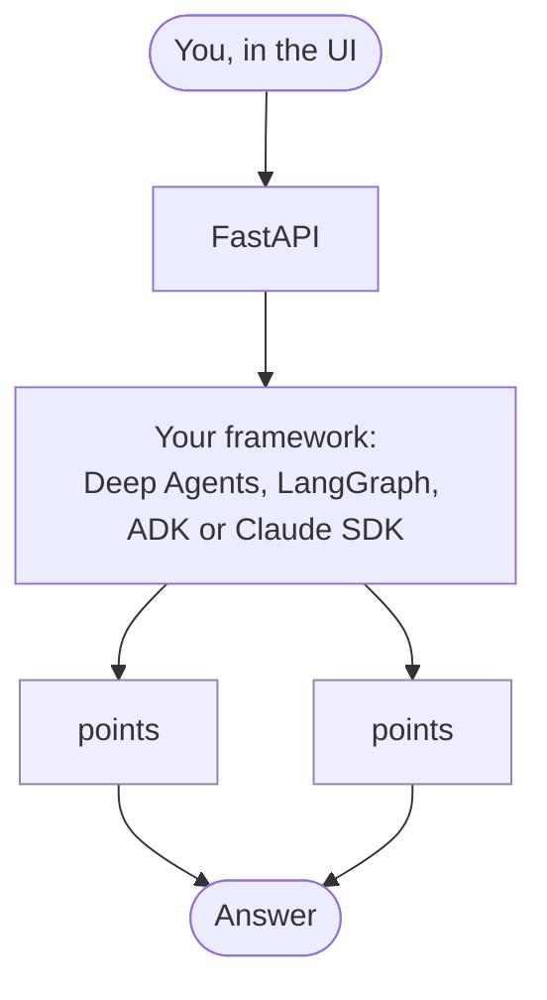

# 097. Points and miles check

**Area:** Travel and getting around  
**Features:** parallel calls

Checks all programs at once.

## What you ask

> How many points do I have, and are any expiring?

## Flow



## Tools

| Tool | Effect | Control |
|---|---|---|
| `points`: Loyalty balance. | read-only | - |

## Run it

```bash
python usecases/097_loyalty_points/usecase.py                 # your preferred framework
python usecases/097_loyalty_points/usecase.py --all           # all four frameworks
python usecases/097_loyalty_points/usecase.py --manual        # answer the approvals yourself
python usecases/097_loyalty_points/usecase.py --framework adk --live   # Gemini decides (needs GOOGLE_API_KEY)
```

Or start the app (`uvicorn app.api:app`), open http://localhost:8000 and pick it from the list.
