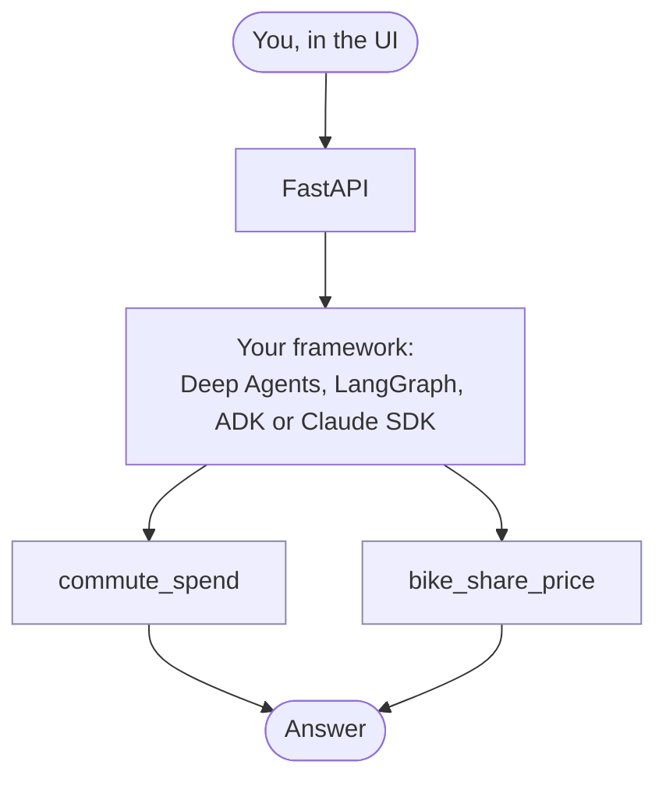

# 098. Cheaper commute

**Area:** Travel and getting around  
**Features:** parallel calls, uses preferences

Compares what you spend on commuting with a bike-share plan.

## What you ask

> Would biking to work save me money?

## Flow



## Tools

| Tool | Effect | Control |
|---|---|---|
| `commute_spend`: Monthly commute spending. | read-only | - |
| `bike_share_price`: Bike share annual plan. | read-only | - |

## Preferences it uses

| Preference | Default |
|---|---|
| `home_city` | Chicago |

## Run it

```bash
python usecases/098_commute_alternatives/usecase.py                 # your preferred framework
python usecases/098_commute_alternatives/usecase.py --all           # all four frameworks
python usecases/098_commute_alternatives/usecase.py --manual        # answer the approvals yourself
python usecases/098_commute_alternatives/usecase.py --framework adk --live   # Gemini decides (needs GOOGLE_API_KEY)
```

Or start the app (`uvicorn app.api:app`), open http://localhost:8000 and pick it from the list.
