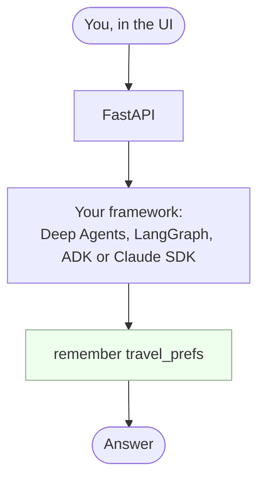

# 099. Remember my travel preferences

**Area:** Travel and getting around  
**Features:** memory

Saved to memory so flight searches follow it.

## What you ask

> Remember: aisle seat, no red-eyes, carry-on only.

## Flow



## Tools

| Tool | Effect | Control |
|---|---|---|
| (only `remember` / `recall`) | memory | - |

## Run it

```bash
python usecases/099_save_travel_prefs/usecase.py                 # your preferred framework
python usecases/099_save_travel_prefs/usecase.py --all           # all four frameworks
python usecases/099_save_travel_prefs/usecase.py --manual        # answer the approvals yourself
python usecases/099_save_travel_prefs/usecase.py --framework adk --live   # Gemini decides (needs GOOGLE_API_KEY)
```

Or start the app (`uvicorn app.api:app`), open http://localhost:8000 and pick it from the list.
