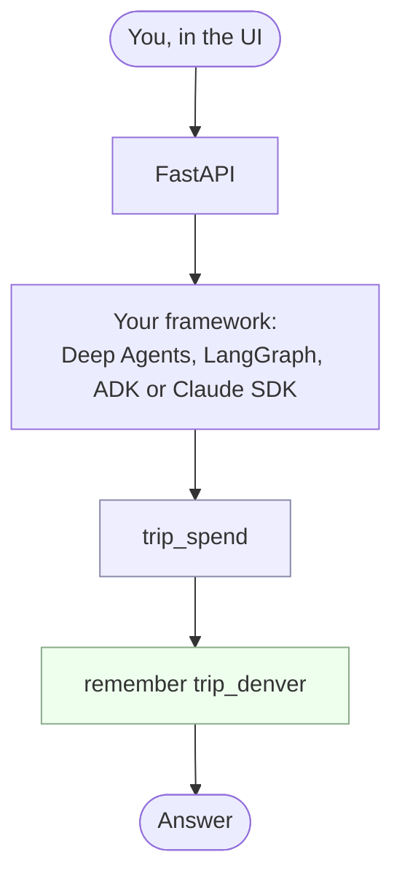

# 100. Trip recap

**Area:** Travel and getting around  
**Features:** memory

Totals spending and saves notes for next time.

## What you ask

> Recap the Denver trip: cost and what I'd do again.

## Flow



## Tools

| Tool | Effect | Control |
|---|---|---|
| `trip_spend`: Total trip spending. | read-only | - |

## Run it

```bash
python usecases/100_trip_recap/usecase.py                 # your preferred framework
python usecases/100_trip_recap/usecase.py --all           # all four frameworks
python usecases/100_trip_recap/usecase.py --manual        # answer the approvals yourself
python usecases/100_trip_recap/usecase.py --framework adk --live   # Gemini decides (needs GOOGLE_API_KEY)
```

Or start the app (`uvicorn app.api:app`), open http://localhost:8000 and pick it from the list.
