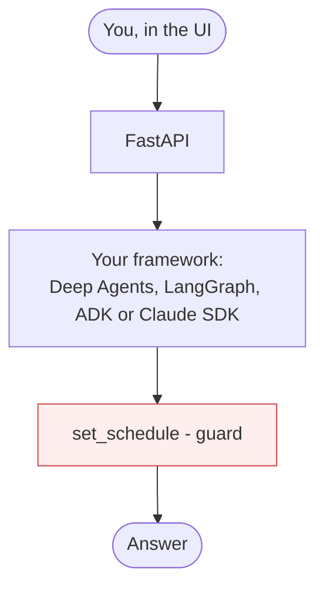

# 101. Set the thermostat schedule

**Area:** Home, family and pets  
**Features:** guard

Writes the schedule. Settings outside 55-75F are blocked.

## What you ask

> Set the heat to 68 when we're home, 60 at night.

## Flow



## Tools

| Tool | Effect | Control |
|---|---|---|
| `set_schedule`: Set a thermostat schedule. | changes your data | guard |

## Guards

Checked in the shared tool layer before the tool runs, the same on every framework. Guards get your preferences, so changing a limit in the UI changes what's allowed.

- `set_schedule`

## Run it

```bash
python usecases/101_thermostat_schedule/usecase.py                 # your preferred framework
python usecases/101_thermostat_schedule/usecase.py --all           # all four frameworks
python usecases/101_thermostat_schedule/usecase.py --manual        # answer the approvals yourself
python usecases/101_thermostat_schedule/usecase.py --framework adk --live   # Gemini decides (needs GOOGLE_API_KEY)
```

Or start the app (`uvicorn app.api:app`), open http://localhost:8000 and pick it from the list.
