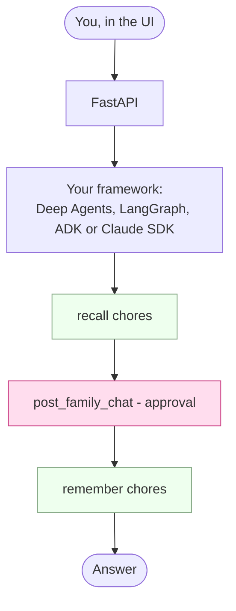

# 102. Weekly chore rotation

**Area:** Home, family and pets  
**Features:** approval, memory, uses preferences

Rotates from last week's list in memory and posts to the family chat after approval.

## What you ask

> Make this week's chore rotation and send it to the family.

## Flow



## Tools

| Tool | Effect | Control |
|---|---|---|
| `post_family_chat`: Post to the family chat. | talks to someone else | approval |

## Approvals

In the UI the run pauses and you decide. With auto-approve (demo), these decisions are used:

- `post_family_chat`: approve

## Preferences it uses

| Preference | Default |
|---|---|
| `dog` | Biscuit |
| `kid` | Maya |
| `partner` | Jordan |

## Run it

```bash
python usecases/102_chore_rotation/usecase.py                 # your preferred framework
python usecases/102_chore_rotation/usecase.py --all           # all four frameworks
python usecases/102_chore_rotation/usecase.py --manual        # answer the approvals yourself
python usecases/102_chore_rotation/usecase.py --framework adk --live   # Gemini decides (needs GOOGLE_API_KEY)
```

Or start the app (`uvicorn app.api:app`), open http://localhost:8000 and pick it from the list.
