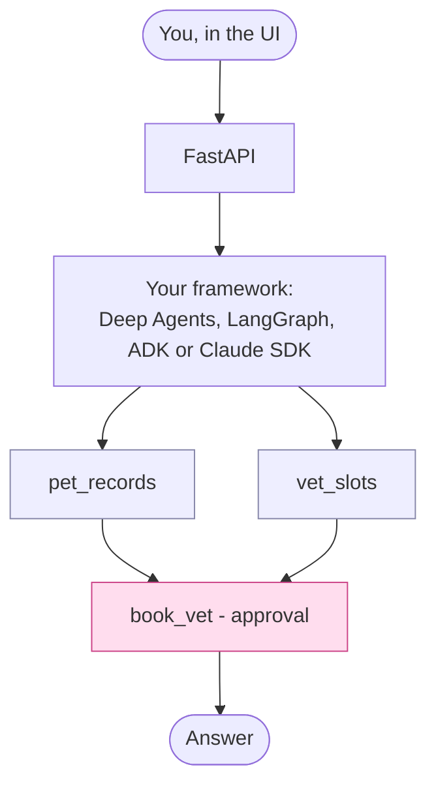

# 103. Vet appointment for the dog

**Area:** Home, family and pets  
**Features:** parallel calls, approval, uses preferences

Checks the vaccine record and books after approval.

## What you ask

> Biscuit is due for vaccines. Book the vet.

## Flow



## Tools

| Tool | Effect | Control |
|---|---|---|
| `pet_records`: Pet vaccine records. | read-only | - |
| `vet_slots`: Vet slots. | read-only | - |
| `book_vet`: Book a vet slot. | talks to someone else | approval |

## Approvals

In the UI the run pauses and you decide. With auto-approve (demo), these decisions are used:

- `book_vet`: approve

## Preferences it uses

| Preference | Default |
|---|---|
| `dog` | Biscuit |

## Run it

```bash
python usecases/103_vet_appointment/usecase.py                 # your preferred framework
python usecases/103_vet_appointment/usecase.py --all           # all four frameworks
python usecases/103_vet_appointment/usecase.py --manual        # answer the approvals yourself
python usecases/103_vet_appointment/usecase.py --framework adk --live   # Gemini decides (needs GOOGLE_API_KEY)
```

Or start the app (`uvicorn app.api:app`), open http://localhost:8000 and pick it from the list.
