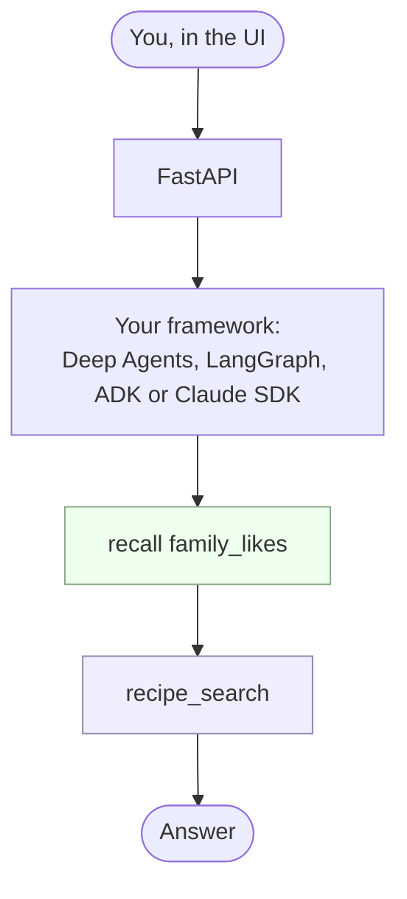

# 106. Plan family dinners

**Area:** Home, family and pets  
**Features:** memory, uses preferences

Uses saved family likes from memory and your diet.

## What you ask

> Plan dinners for the week that Maya will actually eat.

## Flow



## Tools

| Tool | Effect | Control |
|---|---|---|
| `recipe_search`: Recipes. | read-only | - |

## Preferences it uses

| Preference | Default |
|---|---|
| `diet` | vegetarian |
| `kid` | Maya |

## Run it

```bash
python usecases/106_family_dinner_plan/usecase.py                 # your preferred framework
python usecases/106_family_dinner_plan/usecase.py --all           # all four frameworks
python usecases/106_family_dinner_plan/usecase.py --manual        # answer the approvals yourself
python usecases/106_family_dinner_plan/usecase.py --framework adk --live   # Gemini decides (needs GOOGLE_API_KEY)
```

Or start the app (`uvicorn app.api:app`), open http://localhost:8000 and pick it from the list.
