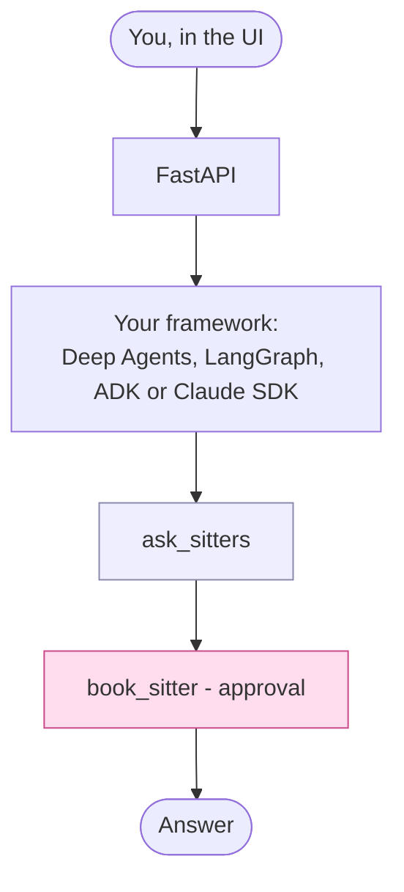

# 107. Book a babysitter

**Area:** Home, family and pets  
**Features:** approval

Asks your saved sitters. Booking is a payment, so it needs approval.

## What you ask

> Book a sitter for Saturday 6-11pm.

## Flow



## Tools

| Tool | Effect | Control |
|---|---|---|
| `ask_sitters`: Check sitters' availability. | read-only | - |
| `book_sitter`: Book a sitter. | spends money | approval |

## Approvals

In the UI the run pauses and you decide. With auto-approve (demo), these decisions are used:

- `book_sitter`: approve

## Run it

```bash
python usecases/107_babysitter_booking/usecase.py                 # your preferred framework
python usecases/107_babysitter_booking/usecase.py --all           # all four frameworks
python usecases/107_babysitter_booking/usecase.py --manual        # answer the approvals yourself
python usecases/107_babysitter_booking/usecase.py --framework adk --live   # Gemini decides (needs GOOGLE_API_KEY)
```

Or start the app (`uvicorn app.api:app`), open http://localhost:8000 and pick it from the list.
