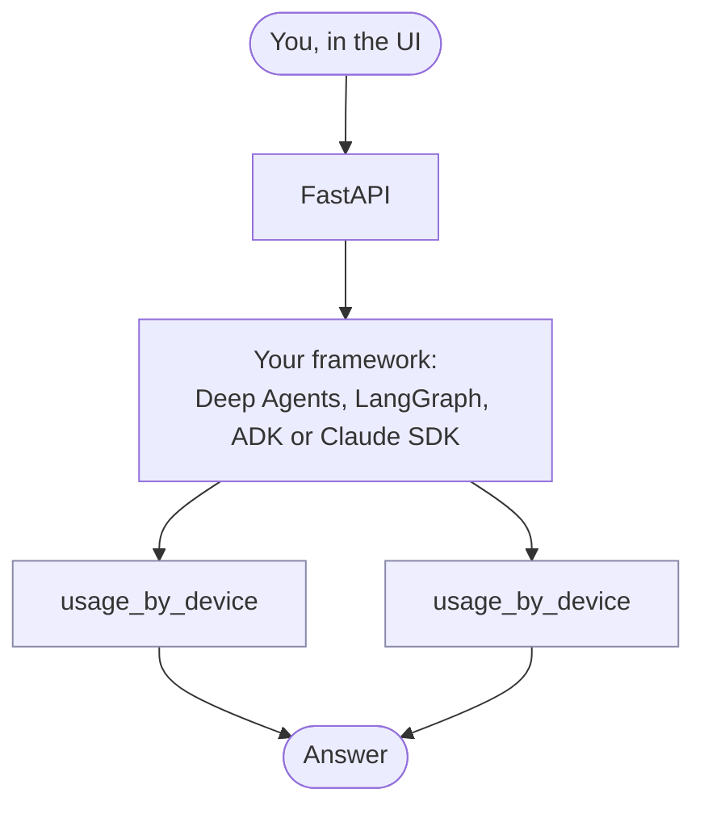

# 109. Why is the electric bill high

**Area:** Home, family and pets  
**Features:** parallel calls

Compares usage by device with last month.

## What you ask

> Why was the electric bill high this month?

## Flow



## Tools

| Tool | Effect | Control |
|---|---|---|
| `usage_by_device`: Energy use by device. | read-only | - |

## Run it

```bash
python usecases/109_energy_usage/usecase.py                 # your preferred framework
python usecases/109_energy_usage/usecase.py --all           # all four frameworks
python usecases/109_energy_usage/usecase.py --manual        # answer the approvals yourself
python usecases/109_energy_usage/usecase.py --framework adk --live   # Gemini decides (needs GOOGLE_API_KEY)
```

Or start the app (`uvicorn app.api:app`), open http://localhost:8000 and pick it from the list.
