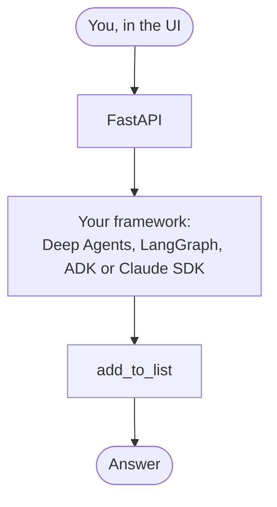

# 111. Shared shopping list

**Area:** Home, family and pets  
**Features:** tools only

Writes to the shared list.

## What you ask

> Add oat milk and coffee to the list Jordan and I share.

## Flow



## Tools

| Tool | Effect | Control |
|---|---|---|
| `add_to_list`: Add items to a shared list. | changes your data | - |

## Run it

```bash
python usecases/111_grocery_with_partner/usecase.py                 # your preferred framework
python usecases/111_grocery_with_partner/usecase.py --all           # all four frameworks
python usecases/111_grocery_with_partner/usecase.py --manual        # answer the approvals yourself
python usecases/111_grocery_with_partner/usecase.py --framework adk --live   # Gemini decides (needs GOOGLE_API_KEY)
```

Or start the app (`uvicorn app.api:app`), open http://localhost:8000 and pick it from the list.
