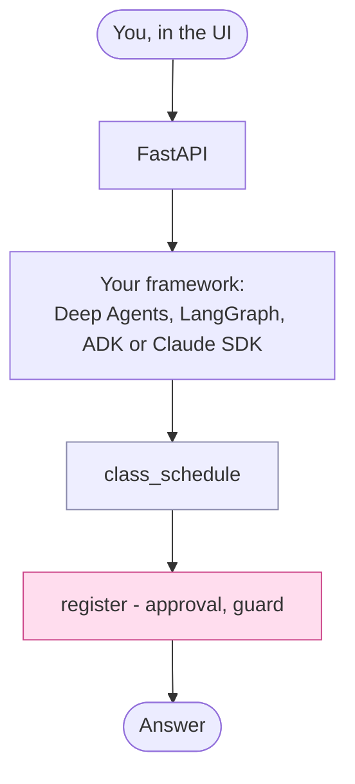

# 112. Sign Maya up for swim class

**Area:** Home, family and pets  
**Features:** approval, guard, uses preferences

Checks the schedule. Registration is a payment that needs approval.

## What you ask

> Sign Maya up for the Saturday swim class.

## Flow



## Tools

| Tool | Effect | Control |
|---|---|---|
| `class_schedule`: Classes at a center. | read-only | - |
| `register`: Register for a class. | spends money | approval, guard |

## Approvals

In the UI the run pauses and you decide. With auto-approve (demo), these decisions are used:

- `register`: approve

## Guards

Checked in the shared tool layer before the tool runs, the same on every framework. Guards get your preferences, so changing a limit in the UI changes what's allowed.

- `register`

## Preferences it uses

| Preference | Default |
|---|---|
| `kid` | Maya |

## Run it

```bash
python usecases/112_kid_activity_signup/usecase.py                 # your preferred framework
python usecases/112_kid_activity_signup/usecase.py --all           # all four frameworks
python usecases/112_kid_activity_signup/usecase.py --manual        # answer the approvals yourself
python usecases/112_kid_activity_signup/usecase.py --framework adk --live   # Gemini decides (needs GOOGLE_API_KEY)
```

Or start the app (`uvicorn app.api:app`), open http://localhost:8000 and pick it from the list.
