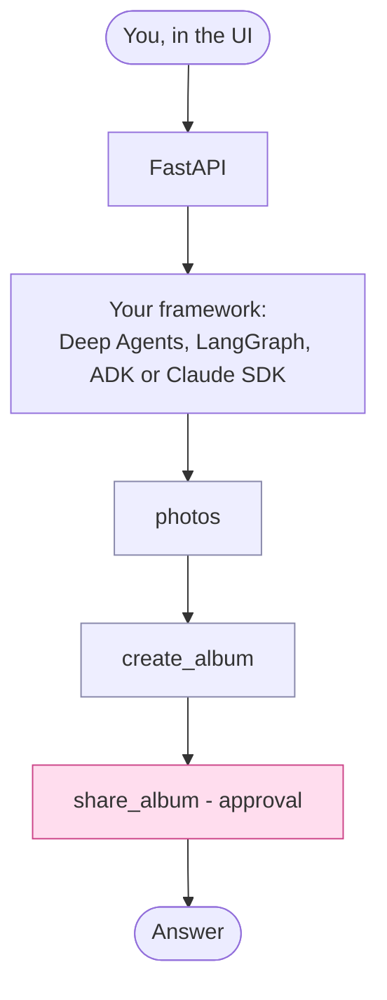

# 114. Make a photo album

**Area:** Home, family and pets  
**Features:** approval

Picks the photos by date. Sharing needs approval.

## What you ask

> Make an album of Thanksgiving photos and share it with family.

## Flow



## Tools

| Tool | Effect | Control |
|---|---|---|
| `photos`: Photos by date. | read-only | - |
| `create_album`: Create an album. | changes your data | - |
| `share_album`: Share an album. | talks to someone else | approval |

## Approvals

In the UI the run pauses and you decide. With auto-approve (demo), these decisions are used:

- `share_album`: approve

## Run it

```bash
python usecases/114_family_photos_album/usecase.py                 # your preferred framework
python usecases/114_family_photos_album/usecase.py --all           # all four frameworks
python usecases/114_family_photos_album/usecase.py --manual        # answer the approvals yourself
python usecases/114_family_photos_album/usecase.py --framework adk --live   # Gemini decides (needs GOOGLE_API_KEY)
```

Or start the app (`uvicorn app.api:app`), open http://localhost:8000 and pick it from the list.
