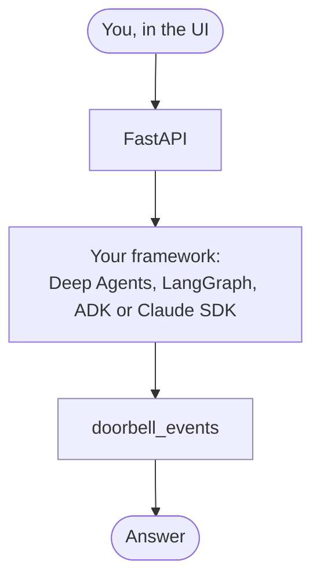

# 116. Who came to the door

**Area:** Home, family and pets  
**Features:** tools only

Summarizes doorbell events.

## What you ask

> Who came to the door today?

## Flow



## Tools

| Tool | Effect | Control |
|---|---|---|
| `doorbell_events`: Doorbell events. | read-only | - |

## Run it

```bash
python usecases/116_security_camera_review/usecase.py                 # your preferred framework
python usecases/116_security_camera_review/usecase.py --all           # all four frameworks
python usecases/116_security_camera_review/usecase.py --manual        # answer the approvals yourself
python usecases/116_security_camera_review/usecase.py --framework adk --live   # Gemini decides (needs GOOGLE_API_KEY)
```

Or start the app (`uvicorn app.api:app`), open http://localhost:8000 and pick it from the list.
