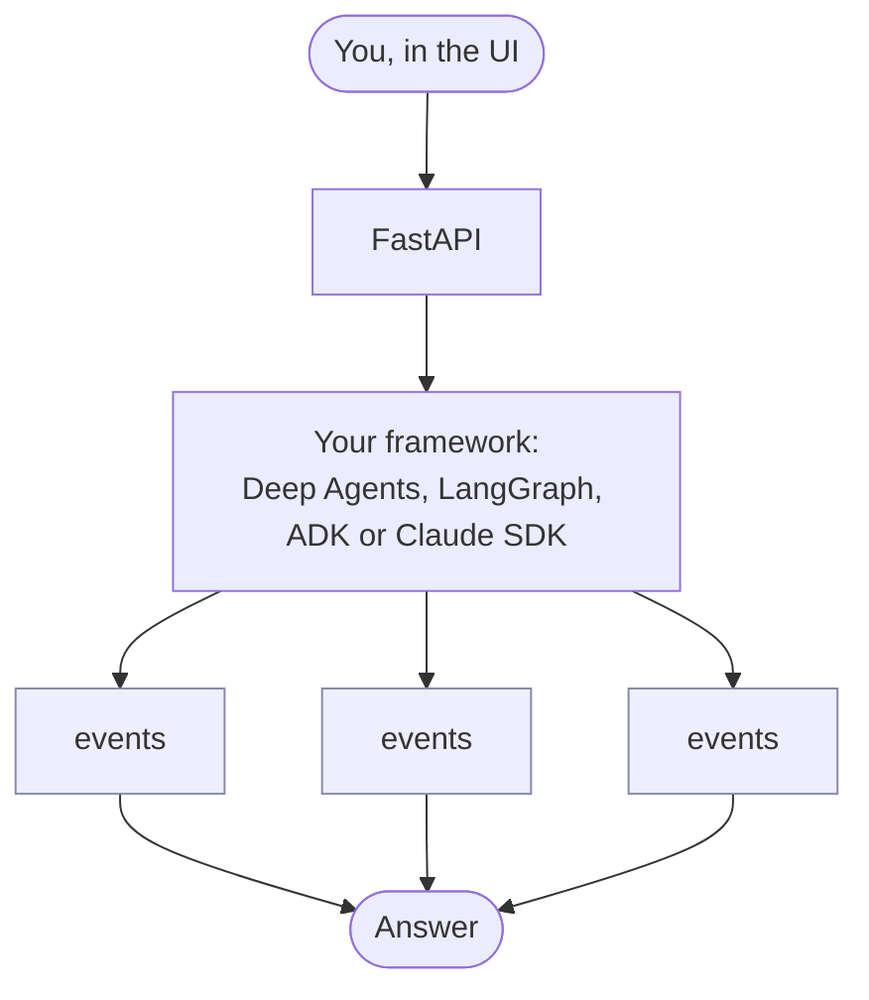

# 117. Family week overview

**Area:** Home, family and pets  
**Features:** parallel calls, uses preferences

Merges three calendars into one view.

## What you ask

> What's the family doing this week?

## Flow



## Tools

| Tool | Effect | Control |
|---|---|---|
| `events`: Events in a calendar. | read-only | - |

## Preferences it uses

| Preference | Default |
|---|---|
| `kid` | Maya |
| `partner` | Jordan |

## Run it

```bash
python usecases/117_family_calendar_week/usecase.py                 # your preferred framework
python usecases/117_family_calendar_week/usecase.py --all           # all four frameworks
python usecases/117_family_calendar_week/usecase.py --manual        # answer the approvals yourself
python usecases/117_family_calendar_week/usecase.py --framework adk --live   # Gemini decides (needs GOOGLE_API_KEY)
```

Or start the app (`uvicorn app.api:app`), open http://localhost:8000 and pick it from the list.
