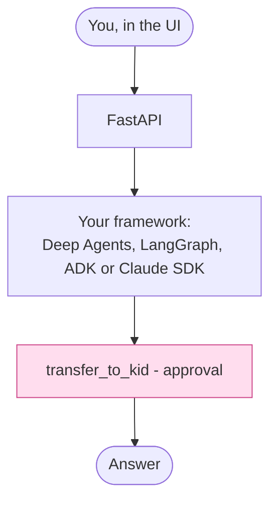

# 118. Kid allowance

**Area:** Home, family and pets  
**Features:** approval, uses preferences

A small transfer to the kid's account after approval.

## What you ask

> Pay Maya's weekly allowance.

## Flow



## Tools

| Tool | Effect | Control |
|---|---|---|
| `transfer_to_kid`: Transfer to the kid's account. | spends money | approval |

## Approvals

In the UI the run pauses and you decide. With auto-approve (demo), these decisions are used:

- `transfer_to_kid`: approve

## Preferences it uses

| Preference | Default |
|---|---|
| `kid` | Maya |

## Run it

```bash
python usecases/118_allowance_tracker/usecase.py                 # your preferred framework
python usecases/118_allowance_tracker/usecase.py --all           # all four frameworks
python usecases/118_allowance_tracker/usecase.py --manual        # answer the approvals yourself
python usecases/118_allowance_tracker/usecase.py --framework adk --live   # Gemini decides (needs GOOGLE_API_KEY)
```

Or start the app (`uvicorn app.api:app`), open http://localhost:8000 and pick it from the list.
