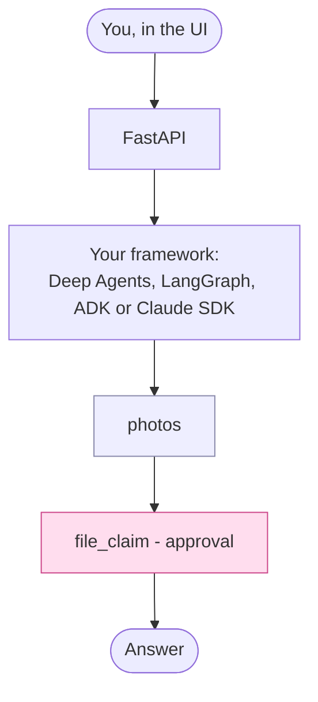

# 119. Start an insurance claim

**Area:** Home, family and pets  
**Features:** approval

Gathers the photos and the plumber's notes and files the claim after you edit it.

## What you ask

> The leak damaged the cabinet. Start a claim.

## Flow



## Tools

| Tool | Effect | Control |
|---|---|---|
| `photos`: Photos by date. | read-only | - |
| `file_claim`: File an insurance claim. | talks to someone else | approval |

## Approvals

In the UI the run pauses and you decide. With auto-approve (demo), these decisions are used:

- `file_claim`: approve with edits `description='Water damage to the kitchen sink cabinet from a supply-line leak. Plumber repaired it on Thursday.'`

## Run it

```bash
python usecases/119_renters_insurance_claim/usecase.py                 # your preferred framework
python usecases/119_renters_insurance_claim/usecase.py --all           # all four frameworks
python usecases/119_renters_insurance_claim/usecase.py --manual        # answer the approvals yourself
python usecases/119_renters_insurance_claim/usecase.py --framework adk --live   # Gemini decides (needs GOOGLE_API_KEY)
```

Or start the app (`uvicorn app.api:app`), open http://localhost:8000 and pick it from the list.
