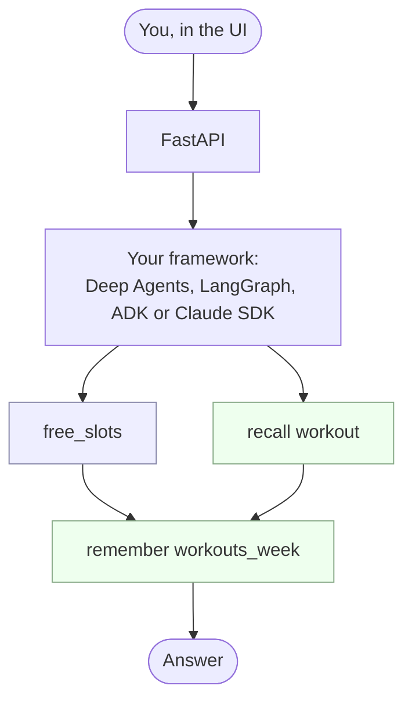

# 121. This week's workouts

**Area:** Fitness, food and appointments  
**Features:** parallel calls, memory

Fits workouts into free slots and saves the plan.

## What you ask

> Plan my workouts around my calendar.

## Flow



## Tools

| Tool | Effect | Control |
|---|---|---|
| `free_slots`: Your free slots this week. | read-only | - |

## Run it

```bash
python usecases/121_workout_plan_week/usecase.py                 # your preferred framework
python usecases/121_workout_plan_week/usecase.py --all           # all four frameworks
python usecases/121_workout_plan_week/usecase.py --manual        # answer the approvals yourself
python usecases/121_workout_plan_week/usecase.py --framework adk --live   # Gemini decides (needs GOOGLE_API_KEY)
```

Or start the app (`uvicorn app.api:app`), open http://localhost:8000 and pick it from the list.
