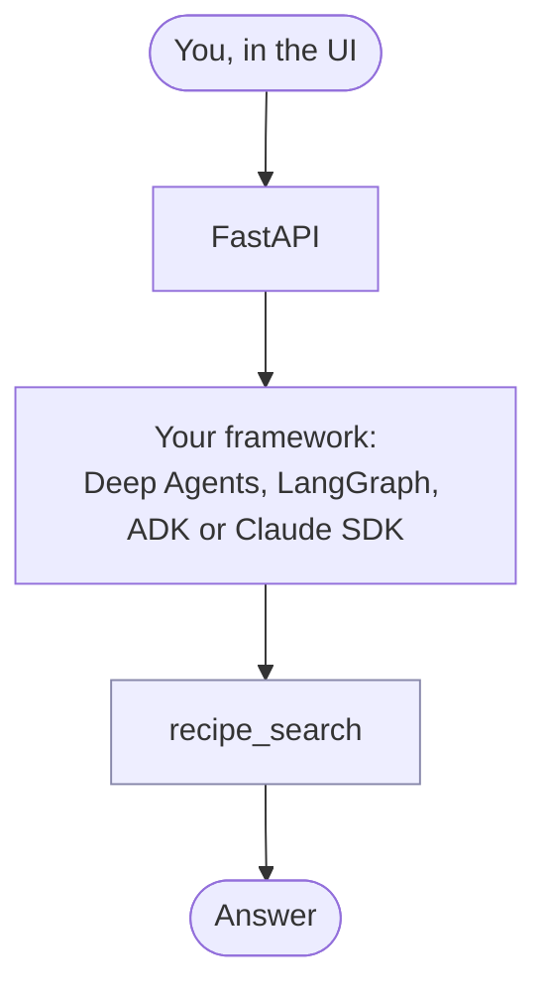

# 124. Sunday meal prep

**Area:** Fitness, food and appointments  
**Features:** uses preferences

Recipes that fit your diet and keep for 4 days.

## What you ask

> Plan a meal prep for weekday lunches.

## Flow



## Tools

| Tool | Effect | Control |
|---|---|---|
| `recipe_search`: Recipes. | read-only | - |

## Preferences it uses

| Preference | Default |
|---|---|
| `diet` | vegetarian |

## Run it

```bash
python usecases/124_meal_prep_sunday/usecase.py                 # your preferred framework
python usecases/124_meal_prep_sunday/usecase.py --all           # all four frameworks
python usecases/124_meal_prep_sunday/usecase.py --manual        # answer the approvals yourself
python usecases/124_meal_prep_sunday/usecase.py --framework adk --live   # Gemini decides (needs GOOGLE_API_KEY)
```

Or start the app (`uvicorn app.api:app`), open http://localhost:8000 and pick it from the list.
