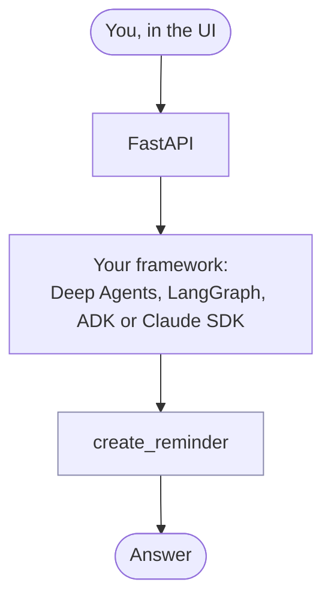

# 125. Drink-water reminders

**Area:** Fitness, food and appointments  
**Features:** uses preferences

Creates reminders inside your work hours only.

## What you ask

> Remind me to drink water every 2 hours during work.

## Flow



## Tools

| Tool | Effect | Control |
|---|---|---|
| `create_reminder`: Create a recurring reminder. | changes your data | - |

## Preferences it uses

| Preference | Default |
|---|---|
| `work_hours` | 09:00-17:30 |

## Run it

```bash
python usecases/125_water_reminder/usecase.py                 # your preferred framework
python usecases/125_water_reminder/usecase.py --all           # all four frameworks
python usecases/125_water_reminder/usecase.py --manual        # answer the approvals yourself
python usecases/125_water_reminder/usecase.py --framework adk --live   # Gemini decides (needs GOOGLE_API_KEY)
```

Or start the app (`uvicorn app.api:app`), open http://localhost:8000 and pick it from the list.
