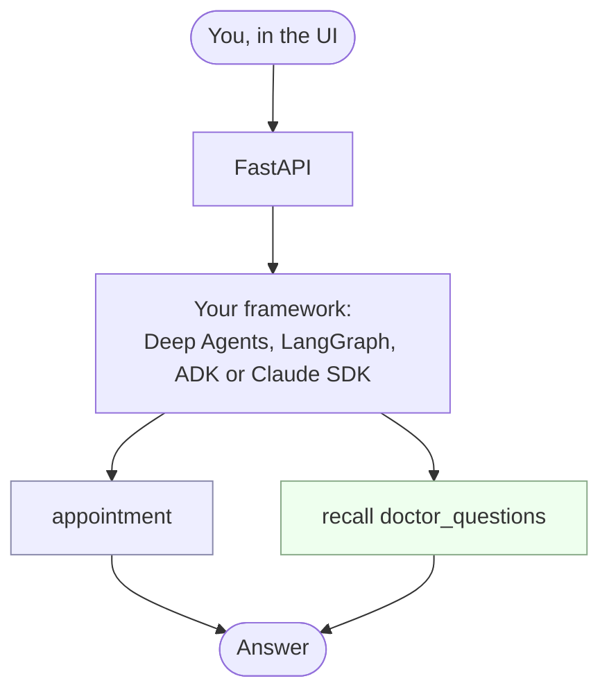

# 126. Prep for a doctor's appointment

**Area:** Fitness, food and appointments  
**Features:** parallel calls, memory

Pulls together the questions you saved and the logistics. It gives no medical advice.

## What you ask

> Help me prepare for my checkup on Friday.

## Flow



## Tools

| Tool | Effect | Control |
|---|---|---|
| `appointment`: Appointment details. | read-only | - |

## Run it

```bash
python usecases/126_doctor_appointment_prep/usecase.py                 # your preferred framework
python usecases/126_doctor_appointment_prep/usecase.py --all           # all four frameworks
python usecases/126_doctor_appointment_prep/usecase.py --manual        # answer the approvals yourself
python usecases/126_doctor_appointment_prep/usecase.py --framework adk --live   # Gemini decides (needs GOOGLE_API_KEY)
```

Or start the app (`uvicorn app.api:app`), open http://localhost:8000 and pick it from the list.
