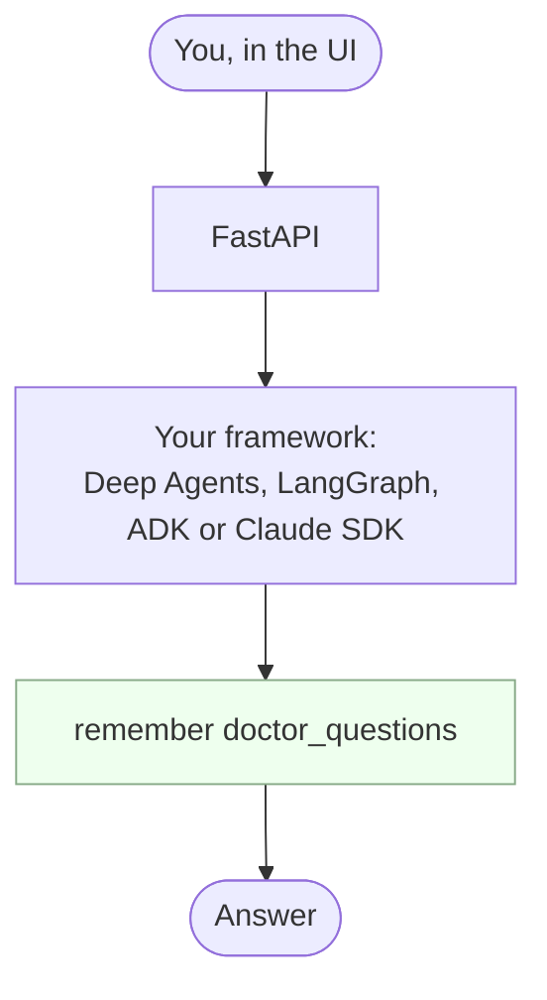

# 127. Save questions for the doctor

**Area:** Fitness, food and appointments  
**Features:** memory

Saved to memory for the appointment prep task.

## What you ask

> Note for my checkup: ask about knee pain when running.

## Flow



## Tools

| Tool | Effect | Control |
|---|---|---|
| (only `remember` / `recall`) | memory | - |

## Run it

```bash
python usecases/127_save_doctor_questions/usecase.py                 # your preferred framework
python usecases/127_save_doctor_questions/usecase.py --all           # all four frameworks
python usecases/127_save_doctor_questions/usecase.py --manual        # answer the approvals yourself
python usecases/127_save_doctor_questions/usecase.py --framework adk --live   # Gemini decides (needs GOOGLE_API_KEY)
```

Or start the app (`uvicorn app.api:app`), open http://localhost:8000 and pick it from the list.
