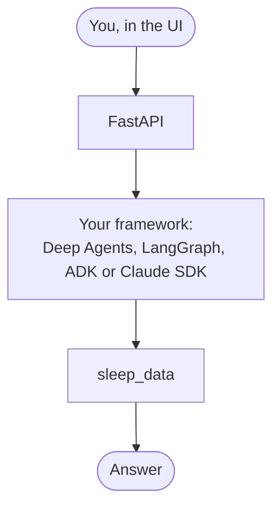

# 128. Sleep summary

**Area:** Fitness, food and appointments  
**Features:** tools only

Reads the sleep tracker for the last week.

## What you ask

> How have I been sleeping?

## Flow



## Tools

| Tool | Effect | Control |
|---|---|---|
| `sleep_data`: Sleep tracker data. | read-only | - |

## Run it

```bash
python usecases/128_sleep_summary/usecase.py                 # your preferred framework
python usecases/128_sleep_summary/usecase.py --all           # all four frameworks
python usecases/128_sleep_summary/usecase.py --manual        # answer the approvals yourself
python usecases/128_sleep_summary/usecase.py --framework adk --live   # Gemini decides (needs GOOGLE_API_KEY)
```

Or start the app (`uvicorn app.api:app`), open http://localhost:8000 and pick it from the list.
